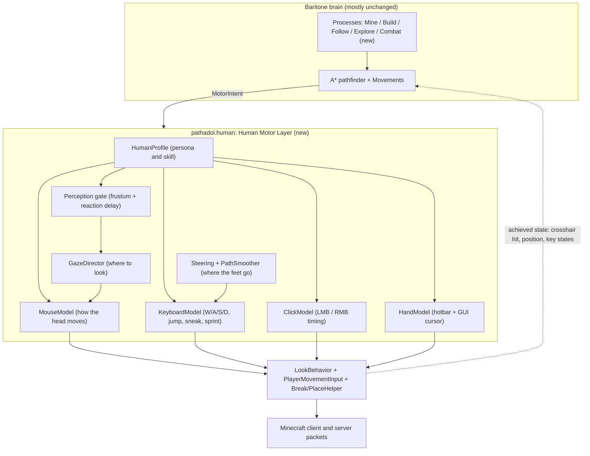

# Pathadol: Full Humanization Plan (Baritone 26.3 Fork)

> [!IMPORTANT]
> All building happens on **GitHub Actions**. Nobody needs to run Gradle or Java locally; download the JAR from the Actions run or a Release.

> [!NOTE]
> **Decisions taken (section 6):** rebrand only (Java packages stay `baritone.*`), standalone Fabric mod, combat supports both 1.8-style and vanilla 26.3 rules via a setting, public repo, command prefix stays `#`.

---

## 0. What "fully human" means (so we can actually test it)

"Looks human" is too vague to build against, so Pathadol uses **measurable targets**. Every subsystem ships with numbers we can check:

| Signal | Baritone today | Pathadol target |
|---|---|---|
| Rotation per tick | Jumps straight to the target in 1 tick | Bell-shaped velocity curve that lasts longer for bigger turns (Fitts' law), small overshoot, then corrections |
| Camera vs. movement | Nose points at the next block, holds W | Gaze leads the path. W/A/S/D are blended so the body follows the path while the head looks elsewhere |
| Path shape | Only straight N/S/E/W lines and exact 45° diagonals | Any angle, rounded corners, no visits to block centers |
| Reaction to new things | Same tick (0 ms) | 150–300 ms delay that varies, and only after the thing is actually on screen |
| Clicks | Fixed tick timers (`rightClickSpeed=4`, `blockBreakSpeed=6`) | Random intervals with natural spread, hold times, over-hold after a block breaks |
| Mining aim | Dead center of the block face | A random point on the visible face that stays put. Pre-aims the next block before the current one breaks |
| Hotbar / GUI | Instant, on the exact tick | Swaps ahead of time, finger delay, cursor travel time in GUIs (Fitts' law) |
| While computing a path | Stands still | Keeps moving, looking, and walking in the right general direction |

**How we'll check it:** Phase 8 (HumanLab) records *your* real gameplay and Pathadol's gameplay in the same format, then compares the distributions in a Colab notebook. A subsystem counts as "human" when its statistics overlap yours.

---

## 1. What the source actually does today (findings from `baritone-26.3`)

I read the real code, not just the earlier chat. The key points:

1. **Camera** ([LookBehavior.java](../src/main/java/baritone/behavior/LookBehavior.java#L211-L307)): `peekRotation()` gets the full target rotation every tick. It only adds random jitter (`randomLooking` 0.01°, `randomLooking113` 2°) and rounds to your mouse sensitivity (`calculateMouseMove`).
   - **Good news:** mouse-sensitivity rounding already exists, so we keep it.
   - **Bad news:** there is no smoothing over time. `smoothLook` only averages the *visual* camera; the rotation the server receives still snaps.
2. **Default freeLook is ON, plus `antiCheatCompatibility`** ([LookBehavior.java](../src/main/java/baritone/behavior/LookBehavior.java#L336-L356)). Baritone sends **silent** rotations to the server while your screen shows something else. A real player's screen and server rotation are always the same thing, so Pathadol defaults to **one shared, visible camera**.
3. **Movement inputs** ([PlayerMovementInput.java](../src/main/java/baritone/utils/PlayerMovementInput.java)): keys are on/off and get rebuilt **from scratch every tick** (`Movement.update()` calls `clearAllKeys()` and re-applies). That allows impossible patterns, like W released and pressed again in the same tick, or keys flickering.
4. **Strafe decoupling half-exists:** `MovementHelper.moveTowardsWithoutRotation()` already picks the W/A/S/D combo closest to a desired direction ([MovementHelper.java](../src/main/java/baritone/pathing/movement/MovementHelper.java#L675-L684)). But most movements use `moveTowards()`, which **aims the camera at the block center and holds W** (lines 666–673). We reuse the existing option picker.
5. **Block breaking** ([BlockBreakHelper.java](../src/main/java/baritone/utils/BlockBreakHelper.java)): it **forces the vanilla destroy delay to 0** (`setDestroyDelay(0)`) and replaces it with its own `blockBreakSpeed` timer. A human holding left-click gets the vanilla delay, so Pathadol stops overriding it.
6. **Placing** ([BlockPlaceHelper.java](../src/main/java/baritone/utils/BlockPlaceHelper.java)): one fixed timer, `rightClickSpeed - 1`.
7. **Bridging** ([MovementTraverse.java](../src/main/java/baritone/pathing/movement/movements/MovementTraverse.java#L287-L346)): only sneak-back-placing (`SNEAK` + `MOVE_BACK`, then waits for `isLookingAt`).
   - The fact that it **already waits for `ctx.isLookingAt(goalLook)`** matters: it means smooth aiming *can* work with movements, as long as every movement waits for the aim to arrive before clicking.
8. **Pathfinding** ([AStarPathFinder.java](../src/main/java/baritone/pathing/calc/AStarPathFinder.java)) expands the fixed `Moves` enum: 8 movement types (Traverse, Diagonal, Ascend, Descend, Fall, Parkour, Pillar, Downward).
9. **Path executor** ([PathExecutor.java](../src/main/java/baritone/pathing/path/PathExecutor.java#L90-L140)) tracks progress by checking whether `playerFeet()` is in each movement's `getValidPositions()`. **This is the main trap:** if you cut corners, the player stands on blocks that aren't in that set, which triggers "off path" and "skip forward" logic. Section 4 handles this.
10. **Hooks already available** (mixins): `MixinClientPlayerEntity`, `MixinMinecraft`, `MixinPlayerController`, `MixinScreen`, `MixinNetworkManager`, plus the events `RotationMoveEvent`, `PlayerUpdateEvent`, `PacketEvent`, `TickEvent`. Almost everything we need can hook into these. Few new mixins are required.
11. **Packaging:** the 26.3 zip is the **Meteor variant** (`"id": "baritone-meteor"`, `mixins.baritone-meteor.json`, no entrypoint), built with Unimined + ProGuard, output to `dist/`. It ships with GitHub Actions workflows (`gradle_build.yml`, `run_tests.yml`) that already build with JDK 25 in the cloud.
12. **License: LGPL-3.0.** Pathadol must keep the license and copyright headers, and must provide source code to anyone you give the JAR to. A public GitHub repo covers that automatically.

---

## 2. Core architecture: the Human Motor Layer

The single most important design decision:

> **Baritone's movements stop pressing keys and snapping the camera directly. They describe an intent, and a new Human Motor Layer turns that intent into physically plausible inputs over time. Movements react to what was *actually achieved* (where the crosshair really is, where the body really is), not to what they requested.**

That one rule fixes both classic smooth-aim bugs from the old plan:
- **Bug A, missed clicks:** clicks only fire once the crosshair has really arrived.
- **Bug B, walking off bridges sideways:** feet are controlled separately from the head.

### 2.1 `MotorIntent` (the new contract)
`MovementState` already stores a `MovementTarget` plus input states. We extend it into an intent object:

| Field | Meaning |
|---|---|
| `lookTarget` | A point in the world, a block face with a stable sample point, or an entity hitbox. Not a raw `Rotation`. |
| `lookPriority` | `MUST_HIT` (break/place/attack), `GUIDE` (movement direction), `FREE` (gaze can wander) |
| `moveTarget` | Desired ground velocity direction and speed class (sneak / walk / sprint), or a corridor |
| `actions` | Requested `BREAK`, `PLACE`, `ATTACK`, `USE`, `JUMP`, `SNEAK`, each with a timing hint (`asap`, `atApex`, `atEdge`) |
| `deadline` | Optional: "this must happen within N ticks or the movement fails" (for example, clutch placements) |

**Migration strategy:** an adapter turns old-style `setTarget(rotation)` and `setInput(...)` calls into an intent automatically. That way all 8 movement types and every process keep working on day one, and we convert them one at a time.

### 2.2 `HumanProfile` (persona)
A seeded profile, chosen per session, with optional presets (`casual`, `average`, `sweaty`):
- Mouse: sensitivity (read from options), peak angular speed, overshoot tendency, tremor amplitude
- Reaction time: log-normal distribution (median about 220 ms, adjustable)
- Clicking: CPS mean/variance, hold-duration distribution, click style (`hold`, `jitter`, `butterfly`)
- Keyboard: minimum key hold, press latency, sprint method (double-tap W vs. sprint key)
- Fatigue: slow drift over a session (slightly slower reactions, more variance)
- Mistake rate: occasional overshot jump, re-aim, misclick on air

Every random draw comes from a `ForkableRandom` seeded from the profile. That lets the pathfinder's lookahead "simulate" the human (existing `fork()` pattern) and makes runs reproducible.

---

## 3. Phase plan (overview)

| # | Phase | Size | Depends on |
|---|---|---|---|
| P0 | Fork, rebrand to Pathadol, GitHub CI | S | – |
| P1 | Motor core: MouseModel, KeyboardModel, MotorIntent adapter | L | P0 |
| P2 | Movement and pathing: smoothing, steering, any-angle, corners | L | P1 |
| P3 | Block breaking / mining | M | P1 |
| P4 | Block placing / bridging / pillaring / clutches | L | P1, P2 |
| P5 | Combat (new CombatProcess) | L | P1, P2 |
| P6 | Inventory, hotbar and GUI | M | P1 |
| P7 | Behavioral texture: idle, glances, waiting, mistakes | M | P1–P4 |
| P8 | HumanLab: recorder, comparison notebook, acceptance tests | M | from P1 onward, in parallel |

Every phase is a sequence of **small PRs**. Each PR goes green on GitHub Actions and produces a downloadable JAR before the next one starts.

---

## 4. Phase details

### P0: Fork, rebrand, CI
**Goal:** a green GitHub build of an unchanged Baritone that is named Pathadol.

1. **Repo:** create `5ivesaw/pathadol`. Preferably start from the upstream git history containing commit `1cdb177f…` (the hash stored in your zip). That lets us merge upstream Baritone fixes later. Otherwise, start fresh from the zip.
2. **Rebrand (visible layer):**
   - `fabric.mod.json`: `id` → `pathadol`, name → `Pathadol`, author → 5ivesaw (with Baritone credited), icon → `Pathadol Icon.png` (scaled down to 128/256 px)
   - Mixin config renamed to `mixins.pathadol.json`
   - Chat prefix `[Baritone]` → `[Pathadol]`; command prefix `#` (configurable, see open questions)
   - Settings file folder `baritone/` → `pathadol/`
   - Java package rename: **open question**, see section 6
3. **CI** (based on the existing `gradle_build.yml`):
   - On push or PR: `./gradlew build`, then upload `dist/*.jar` as artifact `pathadol-<sha>`
   - `run_tests.yml`: unit tests (`./gradlew test`)
   - On `v*` tags: GitHub Release with the JAR attached
   - Your laptop only ever runs: `git push`, `gh run watch`, `gh run download -n pathadol-<sha>`
4. **Done when:** the Actions run is green, the JAR loads in Minecraft 26.3 with Fabric, and `#goto` works exactly like Baritone.

---

### P1: Motor core (the foundation for everything else)

#### P1.1 MouseModel (replaces snapping in `AbstractAimProcessor.peekRotation`)
- **Movement duration from Fitts' law:**

  $$MT = a + b \cdot \log_2\!\left(\frac{D}{W} + 1\right)$$

  Here D is the angular distance and W is the angular size of the target (a block face's apparent size, or the hitbox width).
- **Velocity profile:** minimum-jerk curve, so the turn starts slow, speeds up, and slows down at the end:

  $$\theta(\tau) = \theta_0 + (\theta_1 - \theta_0)\,(10\tau^3 - 15\tau^4 + 6\tau^5),\quad \tau = t/MT$$

- **Sub-movements:** the main movement lands at 92–105% of the distance, followed by one or two small corrections. On big flicks (over about 60°) there's a visible overshoot and settle.
- **Noise:** slow pink-noise (1/f) drift while holding still, plus tiny jitter scaled with speed. This replaces the current flat `randomLooking`.
- **Moving targets:** smooth pursuit with about 80–120 ms lag, plus quick catch-up jumps when the error gets large.
- **"Good enough" zone:** once the crosshair is inside the target's hitbox (shrunk by about 15%), stop correcting and let it drift naturally. Only correct when it's close to slipping off.
- **Keep** the existing `calculateMouseMove` sensitivity rounding as the last step.
- **Two update rates (important):** the server only receives rotations once per tick (20/s), but **your screen** should move smoothly every frame. The model is evaluated continuously over time: the server gets the per-tick sample, and the camera is interpolated each frame through `MixinMinecraft`/render hooks. Otherwise it looks smooth to the server but stutters on your monitor.

#### P1.2 Camera modes
- New default: `freeLook=false`, `antiCheatCompatibility` repurposed. **One shared camera** for your screen and the server.
- The old silent-rotation mode stays available as an opt-in.

#### P1.3 KeyboardModel (replaces per-tick key rebuilding)
- Real key state that **persists between ticks**: press and release events, minimum hold time (≥2 ticks), press latency, no same-tick toggling.
- **Hysteresis:** a key only switches when the desired direction stays changed for long enough. No flickering.
- **Direction to keys:** reuse `MovementOption.getOptions()` (8 combos). Input is the desired travel direction and the camera yaw. Output is the best W/A/S/D combo.
- **Sprint rule (important constraint):** vanilla sprinting needs forward input. So while sprinting, the camera may only drift about ±45° (the W+A / W+D cone) from the travel direction. GazeDirector respects this.
- Sprint is started the human way (double-tap W, or holding the sprint key), with the timing taken from the profile.

#### P1.4 Wiring
- `Movement.update()`: stop clearing all keys every tick. Pass the intent to the motor layer instead.
- `InputOverrideHandler.onTick`: pull the current key and click state from the KeyboardModel and ClickModel.
- `LookBehavior.onPlayerUpdate` / `onPlayerRotationMove`: pull the current rotation sample from the MouseModel.
- `ctx.isLookingAt()` / `objectMouseOver()` become the **only** truth movements check before clicking.

**Done when:** `#goto` across terrain shows no single-tick turns over about 15° (from a HumanLab log), there's no key flicker, and success rate matches stock Baritone on a fixed test course.

---

### P2: Movement and pathing (any-angle, smooth, human)

**Strategy:** **do not touch the A\* search graph** (it's correct and well tuned). Add three layers *after* the search:

#### P2.1 PathSmoother (string-pulling, Theta\*-style, as a post-processing step)
- Split the computed `Path` into segments:
  - **Free-run segments:** consecutive `Traverse` / `Diagonal` / simple `Ascend` / `Descend` moves with nothing to break or place.
  - **Skill segments:** anything with breaking, placing, `Pillar`, `Parkour`, `Fall`, water, ladders.
- Inside free-run segments: greedy line-of-sight pulling. From waypoint *i*, find the farthest *j* such that the **swept player hitbox (0.6 wide) along the straight line** passes these checks for every column: walkable floor at the same height or a valid one-block step, 2 blocks of headroom, no hazards (lava, fire, magma, cactus, edge without fall clearance, `Avoidance` zones). The result is a corridor polyline at any angle.
- Ascends and descends inside a corridor become places where a jump or step is triggered along the line, instead of separate centered moves.

#### P2.2 Steering controller (pure pursuit)
- A lookahead point L ahead on the corridor (about 1.2 blocks walking, 2–3 blocks sprinting). The desired direction points at it, which naturally **rounds corners**.
- Speed control: slow down before sharp turns, edges, or upcoming skill segments.
- Output: desired direction and speed class → KeyboardModel.

#### P2.3 PathExecutor compatibility (the trap from section 1, point 9)
- Each free-run segment gets an **accepted-cells set** = every block covered by the swept corridor. The executor treats these like `getValidPositions()`, so cutting corners doesn't trigger `possiblyOffPath`.
- Progress = position along the corridor polyline, not "which block am I standing on".
- When a skill segment starts, control goes back to the normal `Movement` logic (which is now motor-driven too). That movement gets a "human arrival" zone, not an exact block center.

#### P2.4 Movement-specific changes
| Movement | Change |
|---|---|
| `MovementAscend` | Jump from momentum, timed by the profile; no full stop in front of the step |
| `MovementDescend` / `Fall` | Walk off the edge at the corridor angle; turn toward the landing spot while falling |
| `MovementParkour` / `SprintJump` | Jump direction and checks along the continuous angle; jump timing from distance to edge (with human variance) |
| `MovementDiagonal` | Removed inside free-run segments; only kept where blocks must be broken |
| `MovementPillar` | See P4 |

#### P2.5 GazeDirector (when there's nothing to interact with)
- Look at a point on the path 5–8 blocks ahead at eye height, within the sprint cone.
- Small vertical bobbing tied to the walk cycle (avoids the "only yaw changes" pattern).
- Look toward upcoming skill segments before reaching them (for example, at the block that will need breaking), so P3 and P4 get pre-aiming for free.

#### P2.6 Optional later: true Theta\* inside the search
Only if post-processing isn't enough. This would need cost-model changes (`ActionCosts`) and the fixed-offset assertions in `AStarPathFinder` (`dynamicXZ` checks). That's high risk, so it's deliberately left for later.

**Done when:** on open terrain, the angle histogram of travel directions is continuous (no spikes at 0/45/90°), corners are rounded, the bot never visits block centers, and success rate matches stock Baritone on the test course.

---

### P3: Block breaking / mining
- **Stable target point:** replace `VecUtils.getBlockPosCenter`/face centers in `RotationUtils.reachable` with a sample from a truncated Gaussian on the **visible** face. Sample once per block and keep it (no new point every tick).
- **Respect vanilla timing:** remove `setDestroyDelay(0)` and the separate `blockBreakSpeed` timer from `BlockBreakHelper`. Holding LMB gets vanilla behavior, including the destroy delay between blocks.
- **Start reaction:** a delay before the first click on a new target (from the profile), shorter when it's continuous tunneling and the bot "expects" the next block.
- **Pre-aim:** at 80–90% break progress (read through the existing `IPlayerControllerMP` accessor), start drifting toward the next block's sample point (shared-edge aiming). Then the turn after a break is only a few degrees.
- **Over-hold:** after a break, keep LMB down for 1–3 more ticks, or straight into the next block.
- **Seeing first:** with `legitMine`, `MineProcess` only reacts to ores that have been **in the field of view with clear line of sight** for at least the reaction time. Uses a new perception gate on top of `FasterWorldScanner` / `CachedChunk`.
- **Tool switching:** pick tools ahead of time (see P6) instead of switching on the exact tick (`MovementHelper.switchToBestToolFor`).

**Done when:** time from break to next click and rotation angle per break match the HumanLab distributions, and there's no instant targeting of hidden ores.

---

### P4: Block placing / bridging / pillaring / clutches
- **ClickModel for RMB:** replace the fixed `rightClickSpeed` timer with a generated click stream: interval distribution by style (holding = vanilla 4-tick repeat; jitter/butterfly = random spread, mean 8–14 CPS).
- **Placement windows:** movements state a time window ("valid while the crosshair is on face F and the player is within Δ of the edge"). The ClickModel fires a short burst across that window, not one perfect click.
- **Bridging styles** (new sub-states in `MovementTraverse` / `MovementDiagonal`):

| Style | When | Mechanics |
|---|---|---|
| Sneak back-bridge (current, humanized) | Default, safe | Pitch about 75–80° with drift, moving backward, sneak held, click burst once the crosshair is on the face |
| Ninja bridge | Flat, no threats, `bridgeSkill` ≥ medium | Diagonal yaw offset, S+A/S+D, tap sneak at the edge with ±1 tick variance |
| Diagonal bridge | Diagonal corridor | Matching yaw and key combo |
| Jitter staircase | Upward rush (`MovementAscend` + place) | S + jump, pitch about 70–74°, click stream at jump apex |

- **Pillar** (`MovementPillar`): pitch close to 90° but not exact, timed jump, place near the top of the jump with timing spread.
- **Clutches** (`MovementFall`, water bucket, block clutch): reaction-time-limited. Can **fail** realistically if there isn't enough time. The planner knows that and adds a risk penalty to those moves.
- **Pre-aim:** look at the next placement face 3–4 ticks early (comes from GazeDirector, P2.5).
- **Block budget:** a `blockConservation` slider tied to the existing `blockPlacementPenalty`.

**Done when:** a 30-block straight bridge and a 20-block staircase succeed ≥95% of the time on the test course, with click statistics inside the human band.

---

### P5: Combat (new `CombatProcess`)
Baritone has no combat engine. `FollowProcess` only walks toward a target. New:

- **Process priority:** registered with `PathingControlManager` above Mine/Build. Takes control when a threat enters range and gives it back afterward. Pathing to retreat or regroup uses the normal pathfinder.
- **Target choice:** threat score from distance, facing direction, health, held item, and Bedwars context (bed defender vs. rusher).
- **Aim:** closest point on the enemy hitbox, shrunk by about 15%, using MouseModel pursuit with lag. No pixel-perfect tracking.
- **Hitting:** depends on the combat rules (open question):
  - *1.8-style* (Hypixel and similar via ViaFabricPlus): CPS stream (jitter/butterfly profile), starting to swing slightly before reach.
  - *1.9+ (vanilla 26.3)*: time hits to the attack cooldown, jump-crits, sweeps. Spam-clicking would be unnatural here.
- **Movement during combat:** W-tap / S-tap after a landed hit (hook via `PacketEvent`), circle strafing with randomized direction changes, keeping range, avoiding void edges (prefer positions where the *enemy's* back faces the void).
- **Defense:** shield/block-hitting by version, retreat at low health, eating/healing (P6).

**Done when:** in a test arena against a dummy or a friend, hit-rate, CPS, and aim error are within your recorded range, and the bot never falls into the void on its own during a fight.

---

### P6: Inventory, hotbar and GUI
- **Pre-swapping:** `PathExecutor` looks at the next 2–3 movements. If a pickaxe, shears, or blocks are needed, `InventoryBehavior` switches 4–8 ticks early. Minimum finger delay of about 2 ticks between switching and clicking.
- **Hotbar method:** number key (most common) vs. scroll wheel (passes through the slots in between) as a profile setting.
- **GUI** (`GuiClick`, `MixinScreen`): a virtual cursor with Fitts'-law travel time between slots (about 120–280 ms), a short pause after opening a GUI, and shift-click / drag patterns like a human. Optionally drawn as a visible cursor for debugging.
- **Containers / Bedwars shop:** same model, plus "learned" positions (favorite slots load faster, like muscle memory).
- **Eating/healing:** at reasonable thresholds, not frame-perfect at exactly 6 hunger.

---

### P7: Behavioral texture
- **Never frozen:** while `PathingBehavior` is computing (or waiting for the next segment), keep walking in the known direction, look around, adjust the hotbar.
- **Glances:** short looks toward sounds (mobs, players, block breaking), new entities in the field of view, and the destination.
- **Pauses and hesitation:** small decision pauses before risky moves (gaps, lava).
- **Mistakes:** rare, believable errors (misjudged jump that gets corrected, an extra click on air, overshoot), rate set by the profile.
- **Session variance:** fatigue drift; not every run identical (seed per session).

---

### P8: HumanLab (measuring and proving, runs in parallel from P1)
1. **Recorder** (inside the mod, command `#lab record`): logs per frame/tick: rotation, rotation change, key states, clicks, hotbar, GUI cursor, position, plus events (target appears, block breaks). Output: JSONL in `.minecraft/pathadol/lab/`.
2. You **play normally yourself** for 20–30 minutes (mining, bridging, a few fights). That's your baseline.
3. Pathadol records the same scenarios.
4. **Colab notebook** (`lab/compare.ipynb`, runs on your existing Colab Pro): compares distributions. Rotation speed histogram, peak speed vs. turn size, jerk, click intervals, key changes per second, reaction times, travel direction histogram. Reports a KS distance per metric with pass/fail.
5. **CI:** pure Java unit tests for all models (Fitts curve, minimum-jerk, key hysteresis, click distributions, PathSmoother on synthetic block grids). These need no Minecraft and run on every push in GitHub Actions.

> [!TIP]
> **Bonus:** your HumanLab recordings are exactly the kind of data the failed BBH approach was missing: *your own* human motor data, with Baritone intents attached. Later, a small network could learn the MouseModel/KeyboardModel from them instead of using hand-written curves. Pathadol's intent interface is ready to swap that in.

---

## 5. New settings (namespace `human*`)

| Setting | Default | Purpose |
|---|---|---|
| `humanProfile` | `average` | Preset: casual / average / sweaty / custom |
| `humanSeed` | random per session | Reproducibility |
| `humanReactionMedianMs` | 220 | Perception delay |
| `humanAimSpeed` | 1.0 | Scales Fitts constants |
| `humanOvershoot` | 0.3 | Overshoot tendency |
| `humanCps` / `humanClickStyle` | 10 / jitter | Click model |
| `humanBridgeSkill` | medium | Allowed bridging styles |
| `humanMistakeRate` | 0.02 | P7 |
| `pathSmoothing` | true | P2 on/off (for A/B tests) |
| `steeringLookahead` | 2.0 | Pure pursuit |
| `freeLook` | **false** (changed) | One shared camera |

Every human feature can be **switched off on its own**, so A/B tests against stock Baritone are always possible.

---

## 6. Open decisions (need your answers before P0)

1. **How deep the rename goes:**
   - **(a) Rebrand only** (mod id, name, chat, commands, settings folder; Java packages stay `baritone.*`). Upstream merges stay easy, and addons/Meteor/your BBH `BaritoneAdapter` still work.
   - **(b) Full rename** to `pathadol.*` / `pathadol.api.*`. Cleaner identity, but breaks every addon and makes upstream merges much harder.
   - *My recommendation:* (a) now, (b) optionally later.
2. **Standalone vs. Meteor:** your 26.3 zip is the `baritone-meteor` variant (no entrypoint of its own). Should Pathadol be a **standalone Fabric mod** (recommended) or stay a Meteor add-on?
3. **Combat rules for P5:** where will the bot fight? Hypixel-style 1.8 PvP via ViaFabricPlus, or vanilla 26.3 (1.9+ cooldown combat)? This completely changes the hitting model.
4. **Repo:** public `5ivesaw/pathadol` (fulfills LGPL automatically), or private while developing?
5. **Command prefix:** keep `#`, or something new (for example `.` or `;`)?

> [!WARNING]
> Many servers (Hypixel included) ban any automation, no matter how human it looks. Test in singleplayer or on your own server. Using it elsewhere risks that account.

---

## 7. Order of work after approval
1. Answer the open questions above
2. P0: create the repo, rebrand, first green Actions JAR
3. P8 recorder + P1 motor core (in parallel, because P1 gets measured with P8)
4. P2 → P3 → P4 → P6 → P5 → P7, each as small PRs with a green build and a JAR to download
